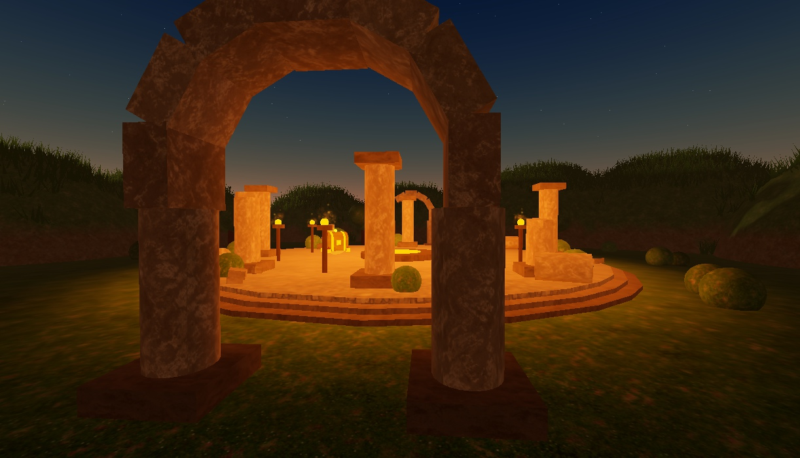
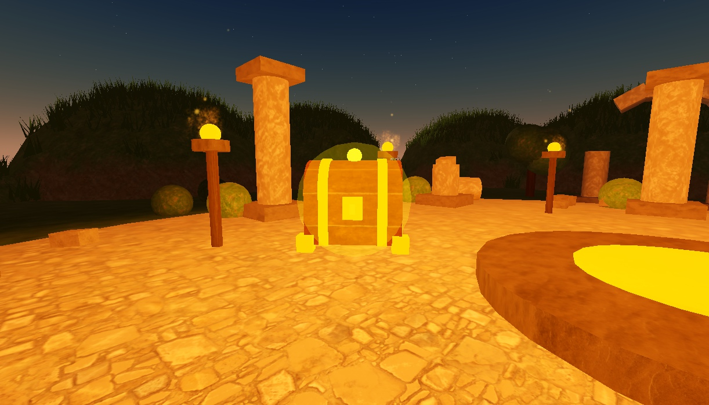

# Sistema de guardado de datos seguro para Roblox, con ruinas y cofres por jugador

Pieza de portafolio. Guarda las monedas y el inventario de cada jugador sin perder datos (ProfileStore, con bloqueo de sesión) y los muestra en pantalla solo a su dueño. Para enseñarlo, viene dentro de una escena: unas ruinas doradas al atardecer donde cada jugador tiene su propio cofre de recompensa.

**Cómo se hizo:** el código se desarrolló dirigiendo a Claude (IA) y se verificó con pruebas en Roblox Studio. No está escrito a mano.




*Las capturas son anteriores a la pasada visual 7 (montañas, camino, árboles y ruinas lejanas). Se actualizarán cuando se pruebe esa pasada.*

## Qué hace

- Al entrar un jugador se cargan sus datos y quedan bloqueados para que ningún otro servidor los use a la vez.
- Al salir (o al cerrar el servidor) se guardan y se liberan.
- Si los datos no se pueden cargar, el jugador es expulsado con un mensaje claro. Nunca juega con datos vacíos que pisarían su guardado real.
- Las monedas y el inventario solo se cambian con funciones del servidor que validan todo.
- Cada jugador ve su propio panel con monedas e inventario. Los demás no pueden ver esos datos.
- Cada jugador tiene **su propio cofre dorado**: flota, gira y brilla. Al recogerlo da 100 monedas y, si cabe, una poción de vida. Aparece un aviso ("Recompensa recibida", "Espera un momento" si es muy pronto, "Monedero lleno" si el saldo está al tope). Luego el cofre desaparece con una animación y el servidor crea el siguiente en otro punto fijo y válido del mapa.
- El cofre de un jugador no se ve ni se puede recoger por los demás.

## Decisiones de diseño

**Los datos solo los ve su dueño.** El servidor copia los datos como atributos en el `PlayerGui` de cada jugador. Roblox solo envía el `PlayerGui` de un jugador a ese mismo jugador. Poner los atributos en el `Player` (la primera versión) los mostraba a todos, y se cambió por esto. Los avisos del cofre usan el mismo camino: un atributo `Notice` con un código que el cliente convierte en texto.

**El cliente solo pone efectos, el servidor decide todo.** No hay ningún `RemoteEvent` ni `RemoteFunction`. El servidor valida dueño, estado del cofre, distancia (14 studs como máximo), cooldown (3 segundos) y los límites de monedas e inventario. Lo que el cliente haga a sus atributos no llega al servidor.

**El cofre se dibuja solo en el equipo de su dueño.** El servidor únicamente crea una caja invisible con el botón de recoger (`ProximityPrompt`) y dos atributos (dueño y estado). El modelo dorado, la luz, las partículas y las animaciones los crea el cliente del dueño. Los demás jugadores nunca reciben el modelo, así que no hay ni un parpadeo de un cofre ajeno.

**Los puntos del cofre son fijos y se validan.** Hay 14 puntos en la plaza. Al arrancar, el servidor comprueba que cada uno tenga suelo y espacio libre y descarta los que no. El siguiente cofre se elige a entre 15 y 45 studs del anterior, sin repetir los últimos dos puntos del jugador ni los puntos de otros cofres.

**Estilo.** Paleta de cinco colores (piedra, piedra oscura, oro, ámbar y musgo, definidos en `Palette.luau`) y dos tipografías (Merriweather para títulos, GothamBold para números). Todo el mapa es terreno y piezas hechas por código; no hay modelos descargados.

## Sonidos

Solo se usan audios de la biblioteca de efectos licenciada de **Pro Sound Effects** que Roblox distribuye en el Creator Store (cuenta verificada ProSoundEffects, "Courtesy of Pro Sound Effects"). No son audios creados por Roblox: la búsqueda no devolvió audios de la cuenta de Roblox, y los de usuarios se descartaron por posibles derechos de autor.

| Momento | ID | Nombre | Duración | Volumen |
|---|---|---|---|---|
| Aparece el cofre | `9116162487` | Key Dings Metal Clinking 3 (SFX) | 2.03 s | 0.35 |
| Se recoge el cofre | `9113728042` | Cash Register 1 (SFX) | 2.11 s | 0.55 |

En Studio se comprobó que ambos cargan y suenan a tiempo. **No se pudo verificar que suenen en un lugar publicado.** Hay que revisarlo tras publicar.

## Archivos y para qué sirve cada uno

**Servidor** (`src/server`)
- `init.server.luau`: punto de entrada, arranca todo en orden.
- `DataTemplate.luau`: los datos con los que empieza un jugador nuevo (0 monedas, inventario vacío). Si se añade un campo nuevo, los jugadores antiguos lo reciben sin perder nada.
- `DataService.luau`: carga y libera los datos de cada jugador, con bloqueo de sesión. Expulsa al jugador si no hay datos.
- `CurrencyService.luau`: sumar y gastar monedas. Rechaza negativos, texto, NaN, infinito y decimales, no deja gastar más de lo que hay, y tiene un tope de 1.000.000.000 (si una suma lo pasaría, no cambia nada y devuelve `OverCap`).
- `InventoryService.luau`: añadir y quitar objetos. Solo acepta objetos del catálogo, cantidades válidas y respeta el máximo de cada objeto.
- `Validation.luau`: la comprobación de cantidades que usan las monedas y el inventario.
- `DataReplicator.luau`: copia los datos al `PlayerGui` del dueño.
- `Notifier.luau`: envía los avisos (recompensa, cooldown, monedero lleno) al `PlayerGui` del dueño.
- `ChestService.luau`: un cofre por jugador, valida todo al recogerlo y crea el siguiente.
- `ChestBuilder.luau`: crea la caja invisible del cofre con su botón de recoger.
- `ChestPoints.luau`: los 14 puntos fijos, su validación y la elección del siguiente.
- `MapBuilder.luau`: arma la escena (plaza, pilares, arcos, antorchas, vegetación, punto de aparición) y llama a los módulos del mundo.
- `MapParts.luau`: piezas básicas y colores que usan los constructores del mapa.
- `Ruins.luau`: pilares y arcos de piedra.
- `WorldLayout.luau`: dónde está la plaza, el camino y las ruinas lejanas, para no taparlos.
- `WorldTerrain.luau`: el suelo en forma de disco, el anillo de montañas lejanas, las lomas, las mesetas y las rocas grandes.
- `Landmarks.luau`: el camino de tierra, los grupos de árboles retorcidos, los muros caídos y dos ruinas lejanas.
- `Packages/ProfileStore.luau`: librería de terceros (ver Licencias).

**Compartido** (`src/shared`)
- `ItemCatalog.luau`: los objetos que existen (Espada, Poción de vida, Gema, Llave) con su máximo. Está congelado.
- `DataAttributes.luau`: los nombres de los atributos con los que el servidor y la pantalla se entienden.
- `ChestShared.luau`: nombres y tiempos que comparten servidor y cliente para el cofre.
- `Palette.luau`: colores y tipografías de toda la escena.

**Cliente** (`src/client`)
- `init.client.luau`: punto de entrada del cliente.
- `HudController.luau`: el panel de monedas e inventario, con el contador animado y el "+100" flotante. Solo lee, no tiene botones.
- `HudIcons.luau`: los íconos del panel, dibujados con elementos de interfaz.
- `Toasts.luau`: los avisos de recompensa, espera y monedero lleno.
- `ChestVisual.luau`: dibuja el cofre dorado (14 piezas) en el equipo de su dueño.
- `ChestEffects.luau`: aparición con rebote, flotar y girar, destello y chispas, y la animación de desaparición.
- `ChestSounds.luau`: los dos sonidos.
- `AmbientEffects.luau`: luciérnagas y polvo en el aire que siguen al jugador, solo cosmético y solo en su pantalla, con una versión más ligera si hay pantalla táctil.

## Cómo instalarlo y probarlo

1. Instala [Rokit](https://github.com/rojo-rbx/rokit) y, dentro de esta carpeta, ejecuta `rokit install` (instala Rojo 7.7.1).
2. En esta carpeta ejecuta `rojo serve` y déjalo abierto.
3. En Roblox Studio abre un lugar Baseplate, ve a Plugins > Rojo y pulsa **Connect**. Rojo mostrará una lista de cambios (la iluminación y el borrado del Baseplate); pulsa **Accept**. Si cambias la estructura de `default.project.json` en una sesión ya abierta, desconecta y vuelve a conectar para que se aplique.
4. Pulsa **Play**. Aparecerás junto a la entrada de las ruinas. Arriba a la izquierda verás el panel de monedas e inventario, y en unos segundos tu cofre aparecerá cerca.
5. Camina hasta el cofre y mantén pulsado el botón que aparece. Recibirás 100 monedas y una poción de vida. Si recoges otro antes de 3 segundos verás "Espera un momento".
6. Para probar con varios jugadores: pestaña Prueba, Clientes y servidores, Jugadores: 3, Iniciar. Cada jugador debe ver solo su cofre y solo sus datos.
7. Para probar en celular: pestaña Prueba, emulador de dispositivos, elige un celular y pulsa Play.

Para usar el sistema desde otro script del servidor (por ejemplo una tienda):

```lua
local result = CurrencyService.spendCoins(player, 50) -- "Ok", "NotEnoughCoins", "InvalidAmount", "NoData"
if result == "Ok" then
	InventoryService.addItem(player, "Sword", 1)
end
```

## Rendimiento

Presupuesto del mapa: unas 210 piezas ancladas, 8 luces sin sombras (antorchas) y 16 emisores de llamas. El terreno (montañas, lomas, rocas) se hace con `Terrain` y no cuenta como piezas. Cada cofre son 14 piezas más una luz y los emisores, y existen solo en el equipo de su dueño. Los efectos de ambiente son dos emisores con unas 90 partículas activas en computador y unas 40 en celular (cálculo: tasa por duración de vida). Las luces no proyectan sombras porque pesan mucho en celular.

*Estas cifras son del diseño. El conteo real de piezas de la pasada visual 7 está pendiente de medir en Studio.*

## Qué está probado y qué no

**Probado** (en Roblox Studio, con el guardado de prueba):
- Cargar y liberar datos al entrar y salir.
- Monedas: sumar, gastar, valores inválidos (negativos, texto, NaN, infinito, decimales, nil), gastar de más y el tope.
- Inventario: añadir y quitar, objetos inventados, ids raros, cantidades inválidas, máximos por objeto.
- El panel con el saldo máximo y los 4 objetos, sin textos cortados (con la herramienta de medir texto del motor).
- 2 y 3 jugadores con la primera versión del cofre: cada uno ve solo sus datos, también tras reaparecer. Un cliente que se pone monedas en su equipo no cambia nada en el servidor.
- Un jugador con el flujo real de cofres (versión anterior a la pasada 7): los 14 puntos son válidos y alcanzables a pie, los cofres sucesivos quedan a 19 a 36 studs, y se comprobaron el cooldown, el monedero lleno, la poción al máximo, el intento desde lejos y el intento de otro jugador.
- Animaciones del cofre medidas: la aparición llega a 3.3 y se asienta en 3.0 con rebote, y la desaparición hincha, sube y encoge.
- Los dos sonidos cargan y suenan a tiempo en Studio.

**Sin probar todavía:**
- **Pasada visual 7 completa** (montañas, relieve, camino, árboles, ruinas lejanas, más luz, luciérnagas y polvo): se escribió sin ver Studio. Falta mirar cada parte en Play y ajustar.
- Cofre por jugador con 3 jugadores y en el emulador de celular tras los últimos arreglos.
- Guardado real entre sesiones: los datos de prueba se borran al detener Studio. Necesita el lugar publicado.
- Expulsión por fallo de carga de datos.
- Choque entre dos servidores que quieren el mismo jugador.
- Los sonidos en un lugar publicado.
- Tablet, consola y un celular real.

## Límites conocidos

Salieron de la revisión de seguridad (un revisor de solo lectura leyó el código y no encontró fallos críticos ni altos):

- **El cofre solo tiene cooldown, sin límite total.** El servidor valida el dueño, el estado, la distancia y el cooldown, pero la posición del jugador la controla su cliente. Alguien con un exploit podría sacar 100 monedas cada 3 segundos hasta el tope. Es una demo. En una tienda o misión real hay que añadir un límite por día o de un solo uso, guardado en los datos del jugador.
- **El cooldown (3 s) es más largo que lo que tarda en aparecer el siguiente cofre (unos 2.2 s).** Si un jugador lo recoge enseguida ve "Espera un momento". Es decisión de diseño.
- **Si algún día se quita un objeto del catálogo**, los jugadores que ya lo tengan lo conservan en su guardado sin poder verlo. Habría que hacer una migración con `SchemaVersion`.
- **El panel redibuja una fila por cambio**; con muchos objetos habría que paginar.

## Licencias

ProfileStore, de MAD STUDIO (loleris), se usa bajo licencia Apache 2.0. La copia completa está en `licenses/ProfileStore-LICENSE.txt` y el origen en `THIRD_PARTY.md`.
